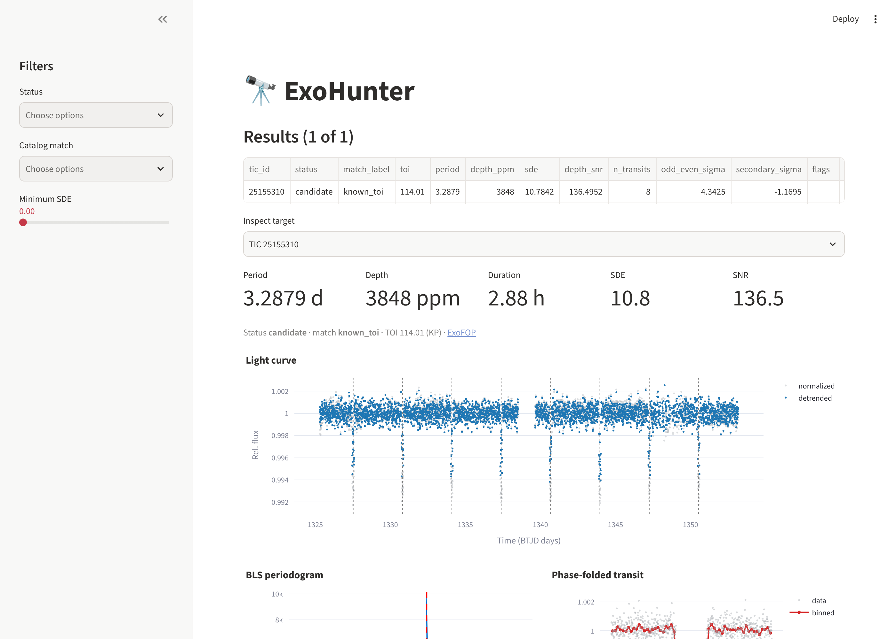

# 🔭 ExoHunter

A learning project that searches **public NASA TESS light curves** for transiting
exoplanets and other periodic dips, rejects common false positives, checks
results against known catalogues, and lets you review candidates in an
interactive dashboard.

> Status: **v0.1 MVP**. TESS 2-minute data, BLS search, basic vetting, TOI cross-match,
> Streamlit dashboard. See [docs/PLAN.md](docs/PLAN.md) for what's next (Gaia, Fermi, ML…).



## Quickstart

Requires Python 3.11+ and [uv](https://docs.astral.sh/uv/) (or plain `pip install -e .[dev]`).

```bash
uv sync --extra dev
```

Analyse one star (WASP-126 b, a known hot Jupiter):

```bash
uv run exohunter analyze 25155310 --sector 1
```

Batch-process 25 stars from sector 1 with 4 processes:

```bash
uv run exohunter sector 1 --limit 25 --workers 4
```

Show stored results:

```bash
uv run exohunter list --status candidate --label no_known_match
```

Open the dashboard:

```bash
uv run exohunter app
```

Data is stored in `./data` (override with `--data-dir` or `EXOHUNTER_DATA`).

## How it works

```
MAST (TESS SPOC light curves) ─▶ detrend ─▶ BLS transit search ─▶ vetting
     ─▶ cross-match NASA Exoplanet Archive TOIs ─▶ DuckDB/Parquet ─▶ Streamlit + Plotly
```

| Module | Job |
|---|---|
| `sources/tess.py` | Find and download light curves from MAST |
| `detrend.py` | Normalise, flatten, clip flares, bin |
| `search.py` | Box Least Squares period search |
| `vet.py` | Odd/even, secondary eclipse, TESS-orbit and SNR checks |
| `crossmatch.py` | Compare with known TOIs (incl. period harmonics) |
| `storage.py` | DuckDB results table + Parquet light curves |
| `pipeline.py` | Ties it together for one star |
| `cli.py`, `dashboard.py` | User interfaces |

Result statuses: `candidate`, `weak`, `likely_eb` (eclipsing binary), `suspect_systematic`.
Catalogue labels: `known_toi`, `new_signal_on_toi_star`, `no_known_match`.

**The interesting rows are `candidate` + `no_known_match` or `new_signal_on_toi_star`.**
Before believing one, check its ExoFOP page (linked in the dashboard).

## Tech choices

- **Python, not Rust.** The astronomy ecosystem (astropy, lightkurve, astroquery) is in Python.
  Rust can be added later for hot spots via PyO3. See [docs/DECISIONS.md](docs/DECISIONS.md).
- **Visualization:** Plotly + Streamlit now; Datashader for millions of points and Aladin Lite
  for sky maps later.
- **Storage:** DuckDB + Parquet, with no server to run.

## Troubleshooting

- **Searches hang or fail with `RemoteServiceError`:** MAST's query service is sometimes slow
  (minutes per query) or briefly down. Retry later. Files already downloaded are cached in `data/cache`.
- **Downloads blocked behind a firewall:** MAST redirects file downloads to
  `stpubdata.s3.us-east-1.amazonaws.com`, so allow that host as well as `mast.stsci.edu` and
  `exoplanetarchive.ipac.caltech.edu`.

## Development

Offline tests use synthetic light curves with injected transits:

```bash
uv run pytest -m "not network"
```

The live test downloads real data from NASA:

```bash
uv run pytest -m network
```

Lint:

```bash
uv run ruff check .
```

## Docs

- [docs/SPEC.md](docs/SPEC.md): MVP specification and acceptance criteria
- [docs/PLAN.md](docs/PLAN.md): phased roadmap and learning goals
- [docs/DECISIONS.md](docs/DECISIONS.md): architecture decision records
- [notebooks/01_rediscover_a_planet.py](notebooks/01_rediscover_a_planet.py): guided first notebook

## Data credits

This project uses data from NASA's TESS mission, retrieved from MAST at STScI, and
the NASA Exoplanet Archive (Caltech/IPAC). Please cite them if you publish anything.

## License

MIT
